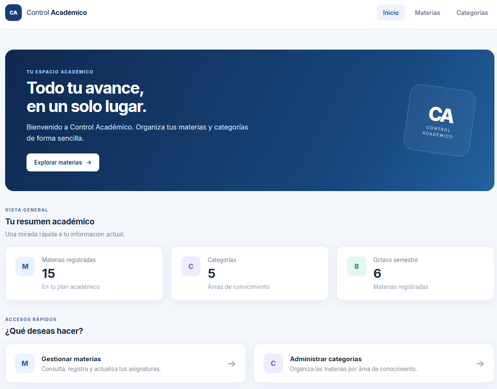
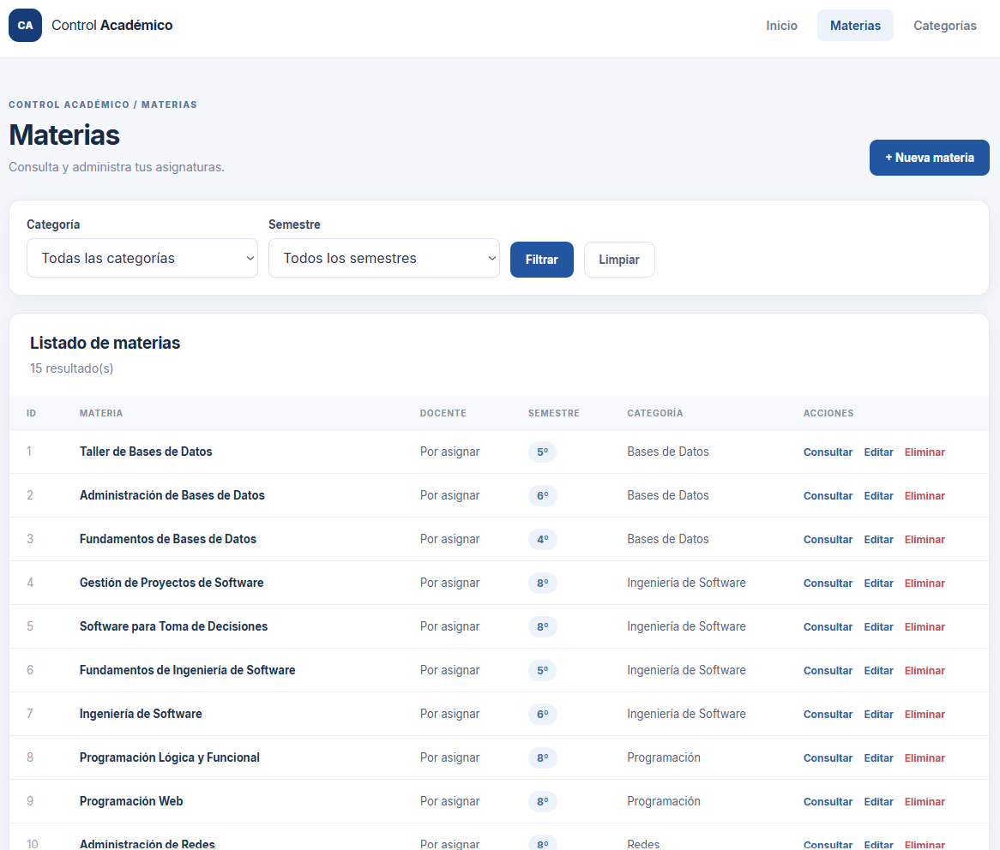
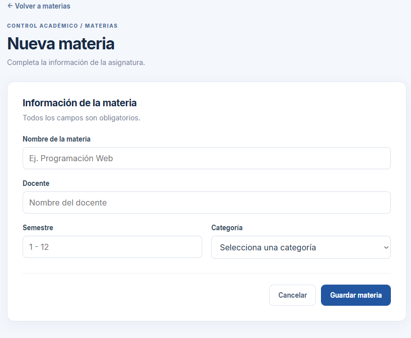
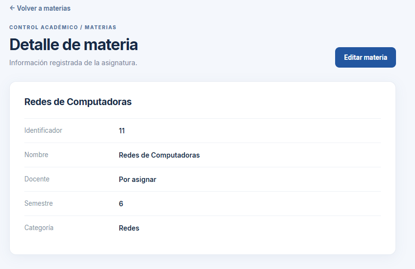
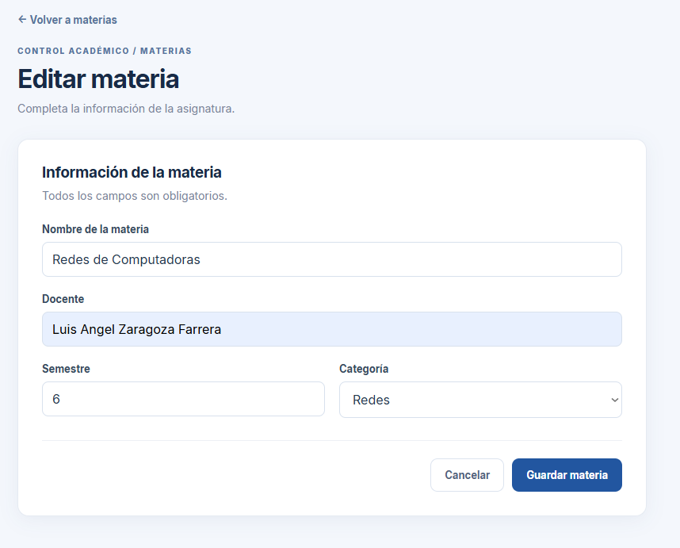
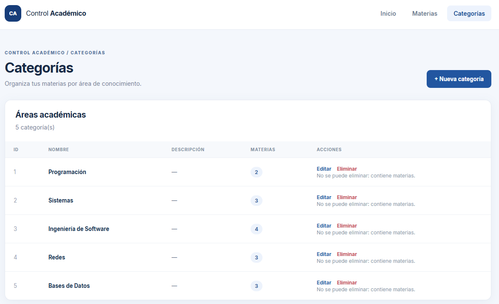
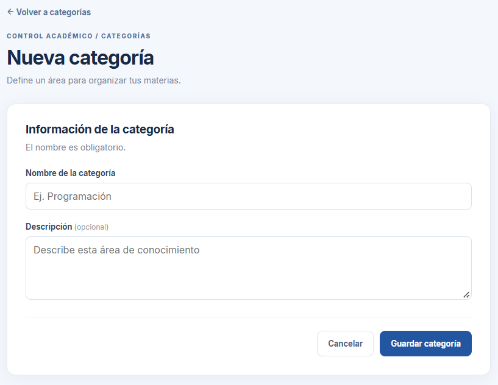
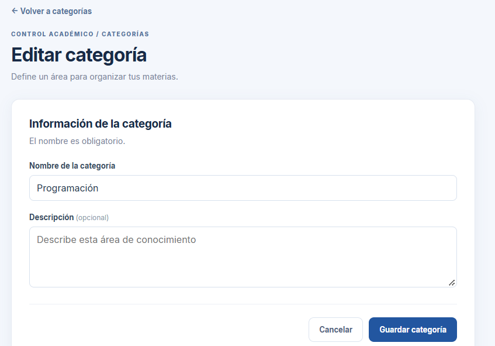
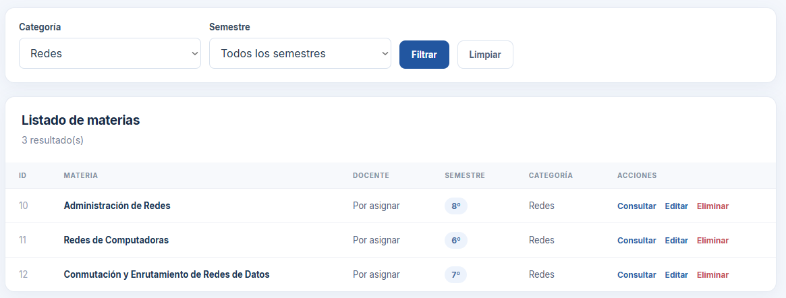
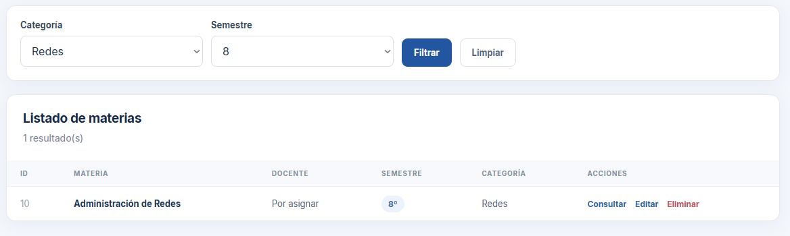

# Control Académico — Actividad 3

Control Académico es una aplicación web para registrar y organizar materias de la retícula de Ingeniería en Sistemas Computacionales y sus categorías. Su objetivo es concentrar la información académica en un solo lugar, evitando depender de listas dispersas para consultar materias, docentes, semestres y áreas de conocimiento.

El sistema ofrece un panel de resumen, administración CRUD de materias y categorías, filtros de búsqueda y una API REST. La información se almacena en MySQL y se consulta desde una interfaz web adaptable construida con Thymeleaf.

## Tecnologías utilizadas

| Tecnología | Función en el proyecto |
| --- | --- |
| **Java 17** | Lenguaje y versión objetivo de compilación. |
| **Spring Boot 4.1.2** | Configura y ejecuta la aplicación web. |
| **Spring MVC** | Gestiona las peticiones de la interfaz y de la API REST. |
| **Spring Data JPA** | Proporciona repositorios para acceder a los datos. |
| **Hibernate** | Implementa el mapeo entre entidades Java y tablas mediante JPA. |
| **MySQL 8** | Almacena las categorías y materias. |
| **Thymeleaf** | Genera las páginas HTML a partir de plantillas y datos del servidor. |
| **Maven y Maven Wrapper** | Gestionan dependencias, compilación, pruebas y empaquetado. |
| **HTML, CSS y JavaScript** | Presentan la interfaz, sus estilos y confirmaciones de eliminación. |

## Arquitectura del sistema

El proyecto separa la presentación, la lógica de negocio y el acceso a datos:

1. **Entidades:** `Categoria` y `Materia` representan las tablas `categorias` y `materias`. Una categoría tiene varias materias (`@OneToMany`); cada materia pertenece a una categoría (`@ManyToOne`). La columna `materias.categoria_id` es la clave foránea que establece la relación.
2. **Repositorios:** `CategoriaRepository` y `MateriaRepository` extienden `JpaRepository` para ofrecer operaciones de persistencia y consultas adicionales, como buscar categorías por nombre o materias por categoría.
3. **Servicios:** `CategoriaService` y `MateriaService` reúnen las operaciones CRUD y las reglas de negocio. Entre ellas se encuentran la validación de datos, la prevención de categorías duplicadas y la prohibición de eliminar una categoría con materias asociadas.
4. **Controladores MVC:** `InicioController`, `MateriaController` y `CategoriaController` reciben las peticiones de navegación y formularios y proporcionan datos a las plantillas Thymeleaf. Las eliminaciones desde la interfaz se realizan mediante POST y solicitan confirmación.
5. **Controladores REST:** `MateriaRestController` y `CategoriaRestController` exponen operaciones bajo `/api/materias` y `/api/categorias`, con entradas y respuestas JSON. Comparten los servicios con la interfaz web.
6. **Validación y errores:** Jakarta Validation y los servicios comprueban nombres, longitudes, docente, semestre y categoría. Los formularios conservan los datos al mostrar errores. La API centraliza errores mediante `@RestControllerAdvice` y devuelve mensajes sin detalles internos de SQL.

Los servicios devuelven registros de transferencia con datos planos; no se exponen directamente a las vistas ni a la API las colecciones bidireccionales de las entidades JPA.

## Funcionalidades CRUD

- **Materias:** registrar, listar, consultar detalles, editar y eliminar. Cada materia contiene nombre, docente, semestre y categoría.
- **Categorías:** registrar, listar, editar y eliminar. El listado muestra nombre, descripción y cantidad de materias asociadas. No se permite eliminar una categoría que tenga materias.
- **Filtros:** el listado de materias permite filtrar por categoría, semestre o ambos a la vez.
- **Panel principal:** muestra el total de materias, el total de categorías y la cantidad de materias del semestre 8, además de accesos rápidos.

## Capturas de funcionamiento

### 1. Página principal

#### Dashboard de Control Académico



El panel presenta un resumen de materias, categorías y materias del octavo semestre.

### 2. Administración de materias

#### Listado de materias



La tabla muestra los datos de las materias y las acciones disponibles para cada registro.

#### Registro de una materia



El formulario permite introducir nombre, docente, semestre y categoría.

#### Detalle de una materia



La vista de detalle presenta la información registrada de Redes de Computadoras.

#### Edición de una materia



El formulario muestra los datos precargados de Redes de Computadoras para modificarlos.

### 3. Administración de categorías

#### Listado de categorías



El listado presenta las categorías, su descripción, la cantidad de materias y las acciones disponibles.

#### Registro de una categoría



El formulario solicita el nombre y permite agregar una descripción opcional.

#### Edición de una categoría



El formulario muestra los datos de la categoría Programación para su edición.

### 4. Búsqueda y filtrado

#### Filtro por categoría Redes



El listado puede limitarse a las materias de una categoría seleccionada.

#### Filtros por Redes y semestre 8



Los filtros de categoría y semestre pueden utilizarse simultáneamente.

## Base de datos

La aplicación utiliza **MySQL 8** con las tablas siguientes:

- `categorias`: tiene una clave primaria `id`, un nombre único y una descripción opcional.
- `materias`: tiene una clave primaria `id`, nombre, docente, semestre y la clave foránea obligatoria `categoria_id`, que referencia `categorias.id`. El esquema limita el semestre al intervalo de 1 a 12.

Los archivos SQL se ejecutan manualmente; no se cargan automáticamente al iniciar Spring Boot:

- [`database/schema.sql`](database/schema.sql): crea las tablas, las restricciones y la relación.
- [`database/datos-iniciales.sql`](database/datos-iniciales.sql): proporciona **5 categorías y 15 materias** de la retícula. Las categorías son Programación, Sistemas, Ingeniería de Software, Redes y Bases de Datos. Las materias tienen inicialmente `Por asignar` como docente; seis pertenecen al semestre 8 y las demás a semestres anteriores.

El script de datos reutiliza categorías por nombre y omite cualquier materia cuyo nombre ya exista, aunque sus otros campos sean distintos. No elimina ni sobrescribe registros. La comparación depende de la intercalación de MySQL y la carga debe ejecutarse una sola vez a la vez, porque los nombres de materias no tienen una restricción de unicidad. En una base vacía se esperan 5 categorías y 15 materias; con datos previos, los totales pueden ser mayores.

La configuración utiliza `spring.jpa.hibernate.ddl-auto=validate`: Hibernate valida que las tablas existentes sean compatibles, pero no las crea ni modifica.

## API REST

La URL base local para los ejemplos es `http://localhost:8087` cuando se inicia con el argumento de puerto indicado más adelante. Para POST y PUT en Postman, selecciona **Body > raw > JSON** y `Content-Type: application/json`.

| Método | Ruta | Función | Éxito |
| --- | --- | --- | --- |
| GET | `/api/categorias` | Listar categorías | 200 |
| GET | `/api/categorias/{id}` | Consultar una categoría | 200 |
| POST | `/api/categorias` | Crear una categoría | 201 y `Location` |
| PUT | `/api/categorias/{id}` | Actualizar una categoría | 200 |
| DELETE | `/api/categorias/{id}` | Eliminar una categoría sin materias | 204 |
| GET | `/api/materias` | Listar materias | 200 |
| GET | `/api/materias?categoriaId=1` | Listar materias de una categoría existente | 200 |
| GET | `/api/materias/{id}` | Consultar una materia | 200 |
| POST | `/api/materias` | Crear una materia | 201 y `Location` |
| PUT | `/api/materias/{id}` | Actualizar una materia | 200 |
| DELETE | `/api/materias/{id}` | Eliminar una materia | 204 |

Para crear una materia, primero se necesita una categoría existente. Por ejemplo, envía `POST /api/categorias`:

```json
{"nombre":"Ciencias","descripcion":"Materias de ciencias"}
```

Respuesta ilustrativa con estado 201:

```json
{"id":1,"nombre":"Ciencias","descripcion":"Materias de ciencias"}
```

Utiliza el ID realmente devuelto en `POST /api/materias`:

```json
{"nombre":"Física","docente":"Ana López","semestre":2,"categoriaId":1}
```

Respuesta ilustrativa con estado 201:

```json
{"id":1,"nombre":"Física","docente":"Ana López","semestre":2,"categoriaId":1,"categoriaNombre":"Ciencias"}
```

Los ID son ejemplos y pueden variar. Para actualizar mediante PUT se utiliza el mismo formato de entrada; la descripción de categoría es opcional. Las respuestas de error usan, por ejemplo, `{"estado":409,"mensaje":"Ya existe una categoría con ese nombre"}`: **400** indica datos inválidos, **404** un registro inexistente y **409** un conflicto de negocio o integridad. Las eliminaciones exitosas devuelven 204 sin cuerpo.

## Pruebas de API con Postman

Archivos importables:

- [Colección Actividad3_ControlAcademico.postman_collection.json](postman/Actividad3_ControlAcademico.postman_collection.json)
- [Entorno Actividad3_DigitalOcean.postman_environment.json](postman/Actividad3_DigitalOcean.postman_environment.json)

1. En Postman, selecciona **Import** e importa el archivo de la colección. Repite la operación con el archivo del entorno.
2. Selecciona el entorno **Actividad 3 - DigitalOcean** en el selector de entornos. Su variable `base_url` apunta a `http://204.48.17.197:8085`. Para probar localmente, cambia su valor actual a `http://localhost:8087` y ejecuta la aplicación local según las instrucciones de instalación.
3. Las carpetas **Categorías**, **Materias** y **Pruebas de validación** contienen las peticiones. Se pueden enviar individualmente con **Send**: los GET de listado son independientes; las consultas por ID, PUT y DELETE requieren primero crear los registros de prueba mediante la colección y conservar las variables del mismo entorno y destino. Los POST y PUT usan cuerpos JSON de ejemplo; revisa la pestaña **Tests** para ver las aserciones.
4. Para el flujo completo, usa **Run collection** desde el inicio, selecciona el entorno y ejecuta una sola iteración a la vez. No ejecutes carpetas aisladas con el runner: los scripts saltan entre carpetas para crear la categoría y la materia, comprobar las validaciones y después eliminar la materia y la categoría de prueba.
5. Se esperan 200 en consultas y actualizaciones, 201 en creaciones, 400 en solicitudes inválidas, 409 al intentar eliminar una categoría con materias, 204 en eliminaciones y 404 al consultar la materia ya eliminada. El runner muestra el resultado de las aserciones; estos valores son expectativas, no resultados de una ejecución realizada aquí.

**Precauciones:** el entorno exportado apunta al servidor público, por lo que ejecutar la colección completa realiza escrituras y eliminaciones reales. Usa preferentemente una base local de prueba o solicita autorización para cualquier otro destino. La colección crea una categoría con nombre único y una materia temporal; guarda sus ID de respuesta en `categoria_id` y `materia_id`, comprueba que coincidan con las marcas de la colección y con el destino, y no utiliza los ID de los datos iniciales. No edites esas variables ni desactives los scripts. Los mecanismos de comprobación no sustituyen una revisión de los recursos antes de borrar.

Si se detiene el runner, falla una petición, se pierde una respuesta o se interrumpe la conexión, pueden quedar registros de prueba y la limpieza automática puede no ejecutarse. Antes de iniciar otra ejecución, identifica por nombre y respuesta los registros temporales que realmente se crearon y elimínalos solo después de verificar que son tuyos; primero la materia y después la categoría. Si la respuesta de creación no confirma un ID, consulta el listado y verifica el recurso antes de actuar. No elimines las 15 materias ni las 5 categorías iniciales. Las variables y marcas se reinician al crear otra categoría de prueba, de modo que no deben usarse para identificar registros de una ejecución anterior.

## Instalación y ejecución local

### Requisitos

- JDK 17 y MySQL 8 en ejecución.
- Acceso a una base local independiente, por ejemplo `araj_act3_dev`.
- Maven Wrapper incluido en el repositorio; no se requiere instalar Maven por separado.

### 1. Preparar MySQL

Crea la base local con una cuenta administradora y usa un usuario de desarrollo con permisos sobre ella. Por ejemplo:

```sql
CREATE DATABASE araj_act3_dev CHARACTER SET utf8mb4 COLLATE utf8mb4_unicode_ci;
CREATE USER 'act3_dev'@'localhost' IDENTIFIED BY 'SUSTITUIR_POR_CONTRASENA_SEGURA';
GRANT ALL PRIVILEGES ON araj_act3_dev.* TO 'act3_dev'@'localhost';
```

Sustituye el marcador por una contraseña local segura. No guardes credenciales reales en archivos versionados. Ejecuta el esquema **una sola vez sobre una base sin esas tablas**. Desde PowerShell, en la raíz del proyecto:

```powershell
mysql --host=127.0.0.1 --port=3306 --user=act3_dev --password araj_act3_dev --execute="source database/schema.sql"
```

El cliente solicitará la contraseña sin incluirla en el comando. Si `mysql` no está en el PATH, utiliza la ruta completa a `mysql.exe`. El esquema fallará si las tablas ya existen; no las elimina ni modifica.

Para cargar las materias de ejemplo con **MySQL Workbench**:

1. Abre la conexión a MySQL local y selecciona `araj_act3_dev` como esquema predeterminado. Verifica que las tablas ya existan.
2. Abre `database/datos-iniciales.sql` mediante **File > Open SQL Script**. Confirma el esquema y ejecuta el script completo con **Query > Execute All**. No ejecutes cargas simultáneas.
3. Comprueba los datos:

```sql
SELECT COUNT(*) AS total_categorias FROM categorias;
SELECT COUNT(*) AS total_materias FROM materias;

SELECT m.nombre, m.docente, m.semestre, c.nombre AS categoria
FROM materias m
JOIN categorias c ON c.id = m.categoria_id
ORDER BY m.semestre, m.nombre;
```

Si ocurre un error durante la transacción del script, ejecuta `ROLLBACK` en la misma sesión y revisa el problema antes de reintentar.

### 2. Configurar las variables

En la misma sesión de PowerShell desde la que se ejecutará Maven:

```powershell
$env:DB_URL = 'jdbc:mysql://localhost:3306/araj_act3_dev'
$env:DB_USERNAME = 'act3_dev'
$env:DB_PASSWORD = Read-Host 'Contraseña de MySQL para desarrollo'
```

La URL y el usuario indicados son también los valores predeterminados de desarrollo; `DB_PASSWORD` debe definirse explícitamente. `Read-Host` muestra el texto escrito en pantalla: usa un entorno privado. Las variables duran durante la sesión actual de PowerShell. `.env.example` presenta valores ilustrativos; un archivo `.env` no es leído automáticamente por Spring Boot sin un mecanismo adicional.

### 3. Compilar y ejecutar

Para compilar sin iniciar el contexto ni conectarse a MySQL:

```powershell
.\mvnw.cmd compile
```

Para iniciar en el puerto local de desarrollo **8087**, sin alterar el puerto predeterminado **8085**:

```powershell
.\mvnw.cmd spring-boot:run "-Dspring-boot.run.arguments=--server.port=8087"
```

Abre `http://localhost:8087/`. Sin el argumento de puerto, `spring-boot:run` utiliza `http://localhost:8085/`.

## Despliegue en DigitalOcean

El despliegue confirmado utiliza Ubuntu 24.04 en DigitalOcean, Java 17, MySQL 8, la base `araj_act3` y el puerto **8085**. El JAR se encuentra en `/opt/spring-act3-araj/act3.jar` y el servicio systemd se llama `spring-act3-araj`. Se confirmó que el servicio estaba activo y habilitado para iniciar automáticamente; la base se cargó inicialmente con 5 categorías y 15 materias.

Para generar el JAR en Windows, con las variables de base de datos necesarias para las pruebas configuradas:

```powershell
.\mvnw.cmd clean package
```

La compilación genera `target/act3-0.0.1-SNAPSHOT.jar` según la configuración actual de Maven. Una transferencia de ejemplo mediante SCP es la siguiente; sustituye el usuario y destino por los autorizados y comprueba permisos antes de actualizar el servicio:

```powershell
scp target/act3-0.0.1-SNAPSHOT.jar USUARIO@SERVIDOR:/RUTA_TEMPORAL/act3.jar
```

Después se instala el archivo en `/opt/spring-act3-araj/act3.jar` y se reinicia el servicio según los procedimientos de administración del servidor. El servicio debe recibir `DB_URL`, `DB_USERNAME` y `DB_PASSWORD` por un mecanismo privado; no deben incluirse contraseñas en el repositorio. La base del VPS es independiente de la base local `araj_act3_dev`.

Comandos de comprobación para un administrador en el VPS:

```bash
java -version
sudo systemctl status spring-act3-araj
sudo systemctl is-enabled spring-act3-araj
sudo journalctl -u spring-act3-araj -n 50 --no-pager
curl -i http://localhost:8085/
curl -i http://localhost:8085/api/materias
curl -i http://localhost:8085/api/categorias
```

`systemctl is-enabled` permite comprobar el arranque automático y `journalctl` consultar los registros del servicio. Evita publicar registros que puedan contener datos sensibles.

## Pruebas

El proyecto contiene **10 pruebas automatizadas**: cuatro en `MvcControllerTests`, cinco en `RestControllerTests` y una prueba de carga del contexto en `Act3ApplicationTests`. Según el resultado de ejecución confirmado para la entrega, las diez finalizaron sin fallos y Maven informó `BUILD SUCCESS`.

Las pruebas MVC y REST usan `MockMvc` y servicios simulados: comprueban, entre otros aspectos, el renderizado de vistas, filtros, validaciones, respuestas, conflictos y separación de rutas. La prueba de contexto inicia Spring Boot y necesita la configuración de MySQL disponible. Las pruebas simuladas por sí solas no demuestran persistencia en una base real.

Para ejecutar la suite en Windows, con MySQL local, el esquema y las variables preparados:

```powershell
.\mvnw.cmd test
```

## Enlaces de entrega

- [Repositorio GitHub](https://github.com/aleksardio/ARAJact3_t4)
- [Aplicación pública: Control Académico](http://204.48.17.197:8085/)
- [Materias](http://204.48.17.197:8085/materias)
- [Categorías](http://204.48.17.197:8085/categorias)
- [API REST de materias](http://204.48.17.197:8085/api/materias)
- [API REST de categorías](http://204.48.17.197:8085/api/categorias)
